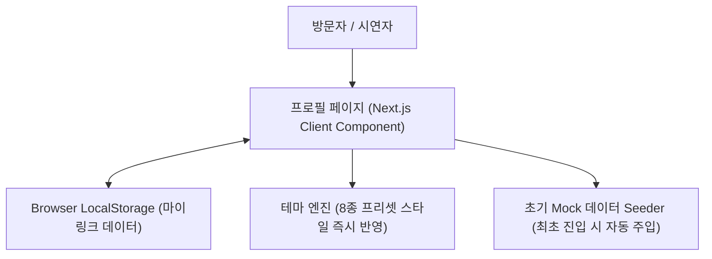
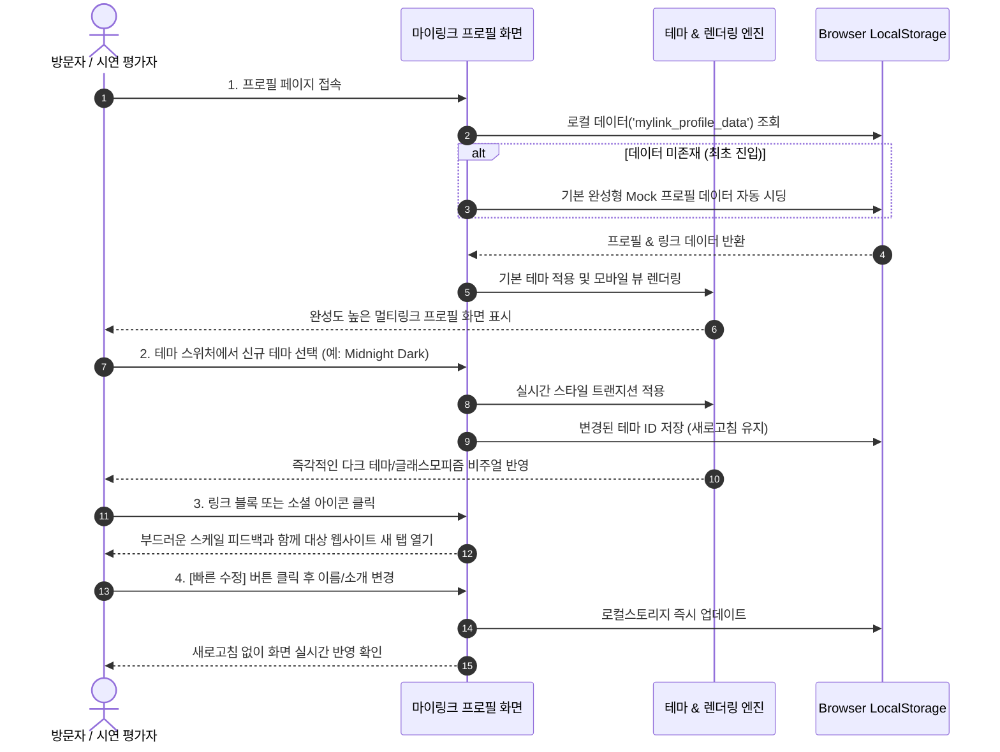

# [PRD] 마이링크 (MyLink) - 제품 기능 정의서 (시연용 단계별 개발 버전)

## 1. 프로젝트 개요 (Overview)
- **서비스명**: 마이링크 (MyLink)
- **목적**: 누구나 손쉽게 자신만의 멀티링크 프로필을 생성하고, SNS 및 웹 링크를 한곳에 모아 공유할 수 있는 범용 올인원 멀티링크 플랫폼
- **현재 진행 전략 (Phased Strategy)**:
  - **시연(Demo) 우선 개발**: 백엔드 서버 설정이나 대시보드/통계 등 무거운 기능을 배제하고, 브라우저 **로컬 스토리지(LocalStorage)**를 활용하여 즉시 시연 및 인터랙션이 가능한 **고완성도 프로필 페이지**를 1단계로 구현합니다.
  - 추후 단계적으로 관리자 대시보드, 백엔드/인증(Supabase), 통계 기능을 순차 확장합니다.

---

## 2. 단계별 개발 범위 (Phase Scope)

| 단계 | 목표 | 주요 구현 내용 | 상태 |
| :--- | :--- | :--- | :--- |
| **Phase 1 (현 단계: 시연 데모)** | **로컬스토리지 기반 프로필 페이지** | • 모바일 최적화 공개 프로필 페이지 뷰<br>• 로컬스토리지 기반 프로필/링크 데이터 로드 및 저장<br>• 기본 웹 링크 목록 및 소셜 아이콘 바<br>• 즉각적인 8종 프리셋 테마 전환 드롭다운/바<br>• 시연용 샘플 Mock 데이터 탑재 및 초기화 기능 | **진행 대상** |
| **Phase 2 (다음 단계)** | **관리자 대시보드 & 편집기** | • 실시간 모바일 목업 프리뷰 스플릿 뷰<br>• 드래그 앤 드롭(DND) 링크 순서 변경<br>• 프로필/링크 편집 폼 | 후속 예정 |
| **Phase 3** | **백엔드 연동 및 소셜 인증** | • Supabase DB 및 Storage 연동<br>• 구글/카카오 소셜 로그인<br>• 고유 핸들(`/[handle]`) 생성 및 중복 확인 | 후속 예정 |
| **Phase 4** | **통계 및 고급 분석** | • 페이지 뷰 및 링크별 클릭수 집계<br>• 대시보드 통계 차트 및 지표 확인 | 후속 예정 |

> **⚠️ Phase 1 제외 사항 (Out of Scope for Demo)**:
> - 대시보드 관리자 페이지 (`/admin`)
> - 방문자/클릭수 통계(Analytics) 기능
> - 소셜 로그인 및 백엔드(Supabase/DB) 연동

---

## 3. Phase 1 핵심 아키텍처 (Client-First Demo)



- **Framework**: Next.js 16 (App Router), React 19, TypeScript
- **Design System & UI**: **shadcn/ui** 기반 + **`design.md` (Apple 스타일 디자인 시스템)**
- **Styling**: Tailwind CSS v4, tw-animate-css, Lucide React (소셜/링크 아이콘)
- **Data Persistence**: Browser `localStorage` (키: `mylink_profile_data`)
- **디바이스 대응**: Mobile-First (중앙 정렬 최대 폭 480px의 세련된 모바일 뷰 카드)

> **💡 디자인 시스템 구축 원칙 (Design System Rule: shadcn/ui × design.md)**:
> 1. **shadcn/ui 컴포넌트 아키텍처 기반**:
>    - 향후 제작되는 모든 UI 컴포넌트(버튼, 모달/다이얼로그, 폼 입력, 드롭다운, 툴팁, 카드 등)는 **shadcn/ui**의 베이스 구조(접근성, 키보드 인터랙션, Radix/Base-UI 헤드리스 로직)를 바탕으로 구축합니다.
> 2. **[design.md](file:///c:/Users/aquadj/Projects/MyLinkProject/design.md)의 Apple 디자인 시스템 스타일 융합**:
>    - shadcn/ui의 기본 테마를 그대로 쓰지 않고, `design.md`에 정의된 **Apple 특유의 절제되고 완성도 높은 디자인 시스템**으로 커스텀 테마화하여 구현합니다.
>    - **단일 포인트 컬러 (Single Accent)**: 모든 주요 인터랙티브 요소는 Action Blue (`#0066cc`, 다크 환경은 Sky Link Blue `#2997ff`)를 단일 인터랙티브 컬러로 적용하며, 잡다한 보조 색상을 배제합니다.
>    - **서피스 및 콘트라스트 (Surfaces)**: Pure White (`#ffffff`), Parchment (`#f5f5f7`), Near-Black Tile (`#272729` / `#2a2a2c`), Frosted Glass 효과를 통한 미니멀한 면 분할과 넉넉한 여백을 활용합니다.
>    - **곡률 체계 (Radii Grammar)**: 주요 액션/CTA는 필(Pill, `rounded-full`), 유틸리티 카드 및 컨테이너는 `{rounded.lg}`(18px) 수준의 부드러운 라운딩으로 규격화합니다.
>    - **시그니처 마이크로 인터랙션**: 모든 클릭 가능 요소에 Apple 시그니처 터치 피드백인 프레스 스케일(`active:scale-[0.95]`, `transition-transform duration-150`)을 적용합니다.
>    - **타이포그래피 및 그림자 절제**: SF Pro / Pretendard 중심의 'Apple tight' 자간(display 음수 letter-spacing)과 17px 본문 체계를 준수하며, 장식적인 그라데이션 및 과도한 박스 그림자는 배제합니다.

---

## 4. Phase 1 상세 기능 명세 (Profile Page Demo)

### 4.1. 프로필 영역 (Profile Header)
- **아바타 이미지**: 원형 프로필 이미지 표시 (기본 제공 고화질 샘플 아바타)
- **타이틀(이름/브랜드)**: 유저명 및 인증 뱃지(선택)
- **한 줄 소개(Bio)**: 사용자의 소개 문구 (예: "크리에이터 & 프론트엔드 개발자 🚀")

### 4.2. 소셜 아이콘 바 (Social Icons Bar)
- 지원 플랫폼: Instagram, YouTube, X(Twitter), GitHub, 이메일, 웹사이트
- 아이콘 클릭 시 해당 소셜 채널로 새 탭 열기
- 브랜드별 아이콘 및 툴팁/호버 효과 지원

### 4.3. 웹 링크 블록 스택 (Links Stack)
- **구성 요소**:
  - 링크 아이콘 / 썸네일
  - 링크 제목 (Title)
  - 보조 설명 (Subtitle/Description)
  - 화살표 인터랙션 아이콘
- **동작**:
  - 클릭 시 해당 URL로 이동 (`target="_blank"`)
  - 마우스 호버 및 모바일 터치 시 부드러운 스케일/그림자 모션 피드백
- **활성화 필터링**: 로컬 데이터 상 `isActive: true`인 링크만 렌더링

### 4.4. 실시간 테마 프리셋 전환 (Theme Switcher for Demo)
- 시연 중 다양한 비주얼을 즉시 보여주기 위해, 화면 상단 또는 하단에 **테마 프리셋 퀵 스위처(Quick Switcher)** 제공
- **지원 프리셋 테마 (8종)**:
  1. `Clean White`: 미니멀 화이트 캔버스 + 깔끔한 블랙 보더 버튼
  2. `Apple Modern`: 은은한 그레이(#f5f5f7) + Action Blue 포인트
  3. `Midnight Dark`: 딥 블랙/차콜 배경 + 은은한 글래스모피즘(Glassmorphism)
  4. `Warm Sunset`: 따뜻한 오렌지/선셋 그라데이션
  5. `Ocean Blue`: 시원한 딥 오션 블루 톤
  6. `Forest Mint`: 차분한 세이지/민트 그린 톤
  7. `Neon Violet`: 트렌디한 네온 퍼플 & 사이버틱 감성
  8. `Soft Peach`: 부드러운 파스텔 피치 톤

### 4.5. 시연 편의 기능 (Demo Utilities)
- **시연용 데이터 리셋 버튼 (Reset to Demo Data)**:
  - 로컬스토리지 데이터를 기본 샘플(개발자/크리에이터 프로필)로 원클릭 복원
- **간단 빠른 수정 모달 (Quick Edit - Option)**:
  - 대시보드 전체 없이도 프로필 이름, 소개글, 테마를 바로 변경해 로컬스토리지에 저장해 볼 수 있는 미니 팝업

---

## 5. 로컬스토리지 데이터 스키마 및 공식 더미 데이터 (Data Schema & Mock Data)

시스템에서 실제 사용 중인 타입 정의는 [`src/types/link.ts`](file:///c:/Users/aquadj/Projects/MyLinkProject/src/types/link.ts), 기본 시딩용 더미 데이터는 [`src/data/mockData.ts`](file:///c:/Users/aquadj/Projects/MyLinkProject/src/data/mockData.ts), 데이터 접근/관리 함수는 [`src/lib/linkService.ts`](file:///c:/Users/aquadj/Projects/MyLinkProject/src/lib/linkService.ts)에 구현되어 있습니다.

### 5.1. TypeScript 타입 스키마
```typescript
// Key: 'mylink_profile_data'
export type SocialPlatform =
  | 'instagram'
  | 'youtube'
  | 'github'
  | 'twitter'
  | 'email'
  | 'website';

export interface SocialLink {
  id: string;
  platform: SocialPlatform;
  url: string;
}

export interface LinkItem {
  id: string;
  title: string;
  url: string;
  icon?: string;
  description?: string;
  isActive: boolean;
}

export interface UserProfile {
  handle: string;
  displayName: string;
  bio: string;
  avatarUrl: string;
  themeId: string; // 'clean-white' | 'midnight-dark' | 'apple-modern' 등 8종 테마
}

export interface MyLinkProfileData {
  profile: UserProfile;
  socialLinks: SocialLink[];
  links: LinkItem[];
}
```

### 5.2. 기본 탑재 더미 데이터셋 (Official Seed Mock Data)

최초 진입 시 또는 초기화 버튼 클릭 시 로컬스토리지(`mylink_profile_data`)에 자동 시딩되는 완성형 더미 데이터입니다.

```typescript
export const MOCK_PROFILE_DATA: MyLinkProfileData = {
  profile: {
    handle: "aquadj99",
    displayName: "이동재 (Dongjae Lee)",
    bio: "사용자 중심의 프론트엔드 아키텍트 & 개발자 🚀\n자연스럽고 반응성이 뛰어난 웹 인터페이스를 만듭니다.",
    avatarUrl: "https://images.unsplash.com/photo-1534528741775-53994a69daeb?w=300&h=300&fit=crop&crop=faces&q=80",
    themeId: "apple-modern",
  },
  socialLinks: [
    { id: "social-1", platform: "github", url: "https://github.com/aquadj99" },
    { id: "social-2", platform: "instagram", url: "https://instagram.com/aquadj99" },
    { id: "social-3", platform: "email", url: "mailto:aquadj99@gmail.com" },
    { id: "social-4", platform: "website", url: "https://github.com/aquadj99" },
  ],
  links: [
    {
      id: "link-1",
      title: "✍️ 기술 블로그 & 엔지니어링 아카이브",
      url: "https://velog.io/@aquadj99",
      icon: "BookOpen",
      description: "Next.js 16과 React 19 아키텍처, 웹 성능 최적화 기록",
      isActive: true,
    },
    {
      id: "link-2",
      title: "🎨 프로덕션 포트폴리오 쇼케이스",
      url: "https://github.com/aquadj99/portfolio",
      icon: "Briefcase",
      description: "실제 런칭 및 운영 중인 웹 서비스 UI/UX 모음",
      isActive: true,
    },
    {
      id: "link-3",
      title: "⚡ GitHub 오픈소스 프로젝트",
      url: "https://github.com/aquadj99",
      icon: "Github",
      description: "MyLink를 포함한 프론트엔드 오픈소스 레포지토리",
      isActive: true,
    },
    {
      id: "link-4",
      title: "📦 Next.js 16 엔터프라이즈 스타터 킷",
      url: "https://github.com/aquadj99/next16-starter-template",
      icon: "Package",
      description: "Turbopack + Tailwind v4 + shadcn/ui 기반 스타터 템플릿",
      isActive: true,
    },
    {
      id: "link-5",
      title: "☕ 개발자에게 커피 한 잔 후원하기",
      url: "https://buymeacoffee.com/aquadj99",
      icon: "Coffee",
      description: "유용한 오픈소스 개발과 기술 글 작성을 응원해주세요",
      isActive: true,
    },
    {
      id: "link-6",
      title: "💼 1:1 커피챗 및 프로젝트 협업 문의",
      url: "mailto:aquadj99@gmail.com",
      icon: "Mail",
      description: "새로운 기술 제안, 채용 및 외주 프로젝트 논의",
      isActive: true,
    },
    {
      id: "link-7",
      title: "🔒 비공개 아카이브 (비활성화 예시)",
      url: "https://example.com/draft",
      icon: "Lock",
      description: "준비 중인 프로젝트 링크 (비활성화 상태)",
      isActive: false,
    },
  ],
};
```

### 5.3. 데이터 연동 인터페이스
- **클라이언트 서비스 함수**:
  - `getMyLinkData()`: 로컬 스토리지에 데이터가 없으면 `MOCK_PROFILE_DATA`를 자동 주입 후 전체 데이터 반환 (SSR 호환)
  - `getLinks(onlyActive?: boolean)`: 링크 목록만 필터링하여 조회 (`onlyActive=true` 시 `isActive === true`인 링크 6개 반환)
  - `saveMyLinkData(data)`: 로컬 스토리지 데이터 갱신
  - `resetToMockData()`: 원클릭 초기 더미 데이터로 리셋
- **HTTP Route Handler**: `GET /api/links` (Next.js App Router API를 통해 JSON 데이터 제공)

---

## 6. 상세 사용자 시나리오 (Detailed User Scenarios)

### 6.1. 시나리오 개요 다이어그램


---

### 6.2. 핵심 시나리오 상세 명세

#### 시나리오 1: 최초 접속 및 완성형 프로필 탐색 (First Visit & Discovery)
- **주요 액터**: 시연 평가자, 서비스 방문자
- **목적**: 별도 가입이나 초기 설정 없이도 즉시 완성도 높은 멀티링크 프로필의 레이아웃과 감성을 확인
- **사전 조건**: 브라우저 로컬스토리지에 기존 저장된 데이터가 없는 상태 (클린 상태)
- **수행 단계**:
  1. 사용자가 웹 애플리케이션 URL에 접속한다.
  2. 시스템은 로컬스토리지에 데이터가 없음을 감지하고, 고품질 샘플 Mock 데이터(크리에이터/개발자 프로필, 대표 링크 4~5개, 소셜 링크 4종)를 자동으로 주입한다.
  3. 중앙 집중형 모바일 뷰(최대 가로 480px)로 프로필 아바타, 이름, 바이오 텍스트, 소셜 아이콘, 링크 카드들이 시각적으로 정돈되어 나타난다.
- **기대 결과**:
  - 흰 화면이나 빈 껍데기가 아닌, 바로 서비스의 완성도를 체감할 수 있는 실제 프로필 페이지가 0.5초 이내에 렌더링된다.

---

#### 시나리오 2: 원클릭 테마 전환 및 비주얼 감상 (Instant Theme Switching)
- **주요 액터**: 시연자, 디자인 관심 사용자
- **목적**: 마이링크가 제공하는 다양한 디자인 프리셋을 원클릭으로 비교 체험
- **수행 단계**:
  1. 사용자가 화면 상단 또는 하단에 위치한 **[테마 프리셋 스위처]**를 확인한다.
  2. 기본 `Clean White` 상태에서 `Midnight Dark` 또는 `Neon Violet`, `Warm Sunset` 등 다른 테마를 클릭한다.
  3. 배경 그라데이션, 카드 배경색, 텍스트 컬러, 버튼의 테두리/그림자 효과가 부드러운 CSS 트랜지션과 함께 실시간 변경된다.
  4. 사용자가 브라우저를 새로고침(F5)한다.
- **기대 결과**:
  - 페이지 리로드 없이 10ms 이내에 즉시 테마가 전환된다.
  - 새로고침 후에도 로컬스토리지에 저장된 테마 상태가 그대로 유지된다.

---

#### 시나리오 3: 소셜 아이콘 및 웹 링크 인터랙션 (Link Navigation)
- **주요 액터**: 방문자
- **목적**: 프로필 소유자의 소셜 미디어 및 외부 웹 링크로 자연스럽게 이동
- **수행 단계**:
  1. 상단 소셜 아이콘 바에서 `Instagram` 또는 `GitHub` 아이콘에 마우스 커서를 올리거나 모바일에서 터치한다.
  2. 아이콘이 위로 살짝 떠오르는 호버 애니메이션과 함께 브랜드 툴팁이 노출된다.
  3. 링크 카드 목록 중 대표 블로그 또는 프로젝트 링크를 클릭한다.
  4. 클릭 시 버튼이 살짝 눌리는 탭(Active scale) 모션이 발생한 후, 새 탭(`target="_blank"`)에서 해당 URL이 열린다.
- **기대 결과**:
  - 모든 링크는 보안 속성(`rel="noopener noreferrer"`)이 적용된 상태로 새 탭에서 안전하게 열린다.
  - 비활성화(`isActive: false`) 처리된 링크는 목록에 노출되지 않는다.

---

#### 시나리오 4: 빠른 프로필 간이 편집 (Quick Edit)
- **주요 액터**: 시연자
- **목적**: 복잡한 관리자 페이지 없이도 이름, 한줄 소개, 링크를 직접 바꿔보며 실시간 반영성 체감
- **수행 단계**:
  1. 프로필 화면 우측 상단(또는 플로팅)의 **[빠른 편집 ✏️]** 버튼을 클릭한다.
  2. 미니 슬라이드오버 또는 팝업 모달이 열리며 이름, 한 줄 소개(Bio), 테마 선택 옵션이 표시된다.
  3. 사용자가 이름을 `홍길동`에서 `테스트 크리에이터`로 수정하고 [저장]을 누른다.
- **기대 결과**:
  - 모달이 닫히며 프로필 헤더의 이름이 즉각 업데이트된다.
  - 로컬스토리지에 즉시 동기화되어 페이지를 껐다 켜도 수정한 정보가 영구 보존된다.

---

#### 시나리오 5: 샘플 데이터 원클릭 리셋 (Data Reset to Default)
- **주요 액터**: 시연자, 테스트 진행자
- **목적**: 이것저것 수정한 데이터를 최초 데모 상태로 빠르고 깔끔하게 복구
- **수행 단계**:
  1. 사용자가 화면 하단 유틸리티 메뉴에서 **[샘플 데이터로 초기화 🔄]** 버튼을 클릭한다.
  2. 확인 안내 팝업("초기 데모 데이터로 복원하시겠습니까?")에서 [확인]을 누른다.
  3. 로컬스토리지의 해당 키 값이 초기 기본 템플릿 데이터로 덮어씌워진다.
- **기대 결과**:
  - 화면이 깜빡임 없이 최초의 이상적인 프로필 샘플 상태로 즉시 복원된다.

---

#### 시나리오 6: 엣지 케이스 및 반응형 디바이스 대응 (Edge Cases & Resilience)
- **주요 액터**: 모바일 및 데스크톱 사용자
- **상황 및 대응**:
  - **긴 텍스트 입력 시**: 링크 제목이나 Bio가 매우 길어질 경우, 줄바꿈(Break-word) 및 말줄임 처리를 통해 모바일 레이아웃이 깨지지 않도록 방어.
  - **데스크톱 대화면 접속 시**: 배경은 넓게 확장되되, 프로필 카드는 인스타그램/스마트폰 비율(`max-w-[480px]`)로 중앙에 미려하게 고정 배치.
  - **스토리지 손상 시**: 로컬스토리지 JSON 파싱 오류 발생 시 앱 크래시를 방지하고 기본 Mock 데이터로 자동 복구(`Fallback`).

---

## 7. 향후 확장 로드맵 (Next Steps)

1. **Phase 1 (현재)**: 로컬스토리지 기반 프로필 페이지 및 8종 테마 완성
2. **Phase 2**: 모바일 목업 실시간 미리보기가 포함된 대시보드 편집기 (`/admin`) 개발
3. **Phase 3**: Supabase Auth(구글/카카오) 및 Database 연동으로 클라우드 저장 및 고유 URL 발급
4. **Phase 4**: 방문자 수 및 링크 클릭수 통계(Analytics) 대시보드 구축
